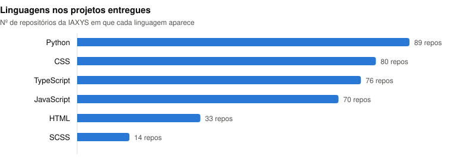

<h1 align="center">Glicio Junior</h1>

  <strong>CEO &amp; CTO da <a href="https://www.iaxys.com.br">IAXYS</a></strong> · Arquitetura de Negócios e Plataformas Escaláveis 
  Estratégia, tecnologia e crescimento empresarial — operação que roda sozinha e escala sem perder controle. 
  📍 Salvador, BA 🇧🇷

  
  
  
  

---

## Sobre

Executivo de tecnologia e empreendedor com **8+ anos** entre vendas consultivas de software, gestão comercial e liderança técnica. Hoje atuo como **CEO & CTO da IAXYS** e como **CTO de empresas parceiras** em fintech, legaltech, educação e construção civil — definindo arquitetura, liderando times e transformando necessidade de negócio em plataforma que escala.

Comecei do lado do cliente (SDR → executivo de contas → gerente comercial → sócio de franquia de ERP). Essa base é o que faz eu desenhar tecnologia pensando em **processo, margem e operação real**, não só em código.

## O que eu entrego

| Frente | Na prática |
| --- | --- |
| 🏗️ **Arquitetura de plataformas** | Sistemas escaláveis, seguros e resilientes, com alta disponibilidade e observabilidade |
| 🔗 **Integração de sistemas** | APIs REST, webhooks e arquitetura orientada a eventos ligando ERP, CRM, pagamentos e canais de atendimento |
| ⚙️ **Automação de processos** | Workflows serverless, ETL, RPA e rotinas financeiras/fiscais que eliminam trabalho manual |
| 🤖 **IA aplicada** | Agentes conversacionais, LLMs com ferramentas, RAG e processamento inteligente de documentos |
| 📊 **Dados & inteligência operacional** | Pipelines de dados, KPIs e dashboards para decisão executiva |
| 🛡️ **Governança & segurança** | LGPD, criptografia, RBAC, auditoria, documentação técnica e gestão de propriedade intelectual |

## Experiência atual

| Empresa | Papel | Desde |
| --- | --- | --- |
| **[IAXYS](https://www.iaxys.com.br)** | CEO & CTO — software house de integração, automação e IA aplicada | 2021 |
| **[UnityPay](https://www.unitypay.com.br/)** | CTO — infraestrutura financeira: BaaS, adquirência, PDV, Tap to Pay | jul/2025 |
| **RecupNet** | CTO — operação jurídica 100% digital, escalando de 10 para 500 contratos/dia | ago/2025 |
| **UniAbad** | CTO — sistema de gestão corporativa (financeiro, acadêmico, RH, compliance) | mai/2025 |
| **UiDo** | CTO — plataforma mobile e web para profissionais da construção civil | mai/2025 |
| **TUS** | CTO — arquitetura de sistemas, integrações e squads de desenvolvimento | abr/2024 |

<strong>Trajetória anterior</strong>

 

| Período | Empresa | Papel |
| --- | --- | --- |
| 2020 – 2024 | Franquia Omie (Salvador) | Sócio, gerente de franquia e CTO |
| 2020 – 2022 | Salvador Consultoria & Soluções | Sócio consultor |
| 2019 – 2020 | Fortes Tecnologia | Gerente comercial |
| 2018 – 2022 | Omie | Especialista de produto → SDR → executivo de contas → gerente comercial |

## Competências

  

  

## Stack técnica

| Área | Tecnologias |
| --- | --- |
| **Linguagens** | Python · TypeScript · JavaScript · SQL |
| **Backend** | FastAPI · Flask · Node.js · REST · Webhooks · Arquitetura orientada a eventos |
| **Frontend** | React · Next.js · Tailwind CSS |
| **Dados** | PostgreSQL · MongoDB · ETL · Modelagem de dados |
| **IA** | LLMs · Agentes com ferramentas · RAG · Prompt engineering |
| **Infra & DevOps** | Docker · Serverless · CI/CD · Linux · Cloud |
| **Práticas** | Arquitetura limpa · Testes · Versionamento Git · Documentação técnica · Ágil (Scrum/Kanban) |

## Formação & certificações

- 🎓 **Universidade Salvador (UNIFACS)**
- 📜 Java Universe — IEEE (2017)
- 📜 JavaFX — IEEE (2016)
- 📜 Crisol — Software Livre

## Escrevo sobre

Gestão ágil de times técnicos · Precificação por valor em projetos de tecnologia · Automação de rotinas empresariais · Produto com foco em negócio

> 💻 O código dos projetos fica na organização **[@IaxysTecnologia](https://github.com/IaxysTecnologia)**.

---

  <em>"Tecnologia é só o meio. O que importa é o impacto."</em>

